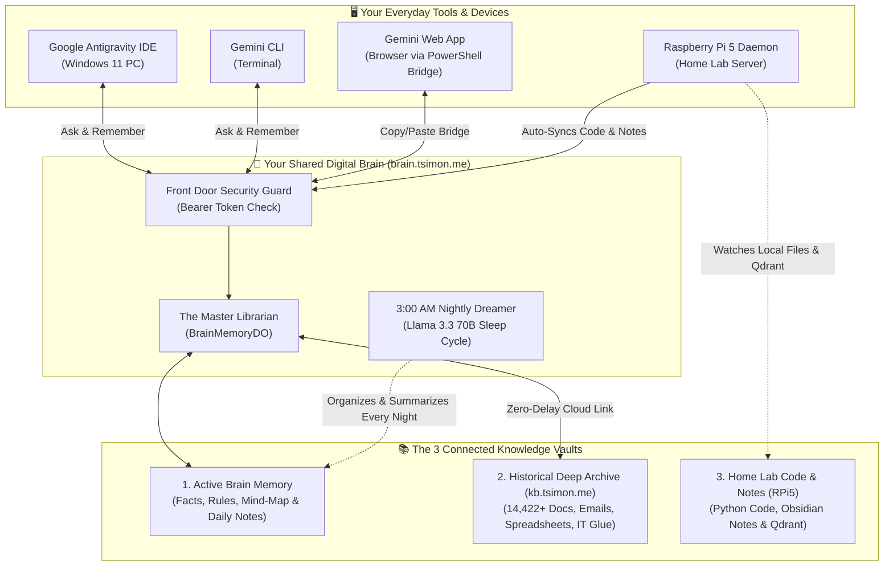
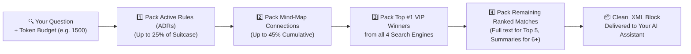
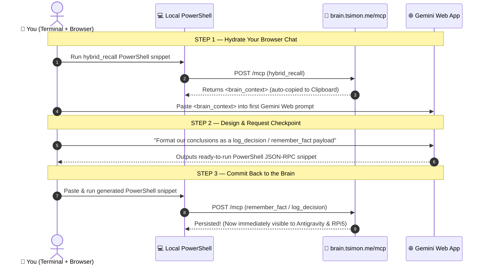
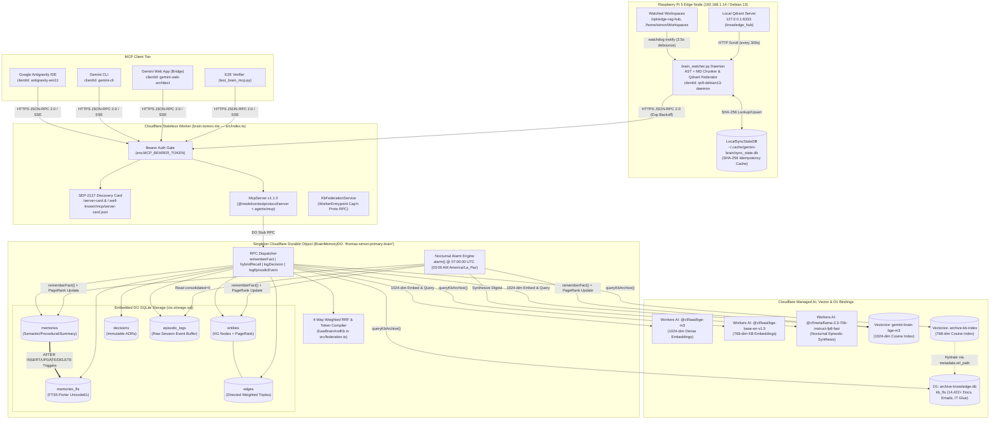
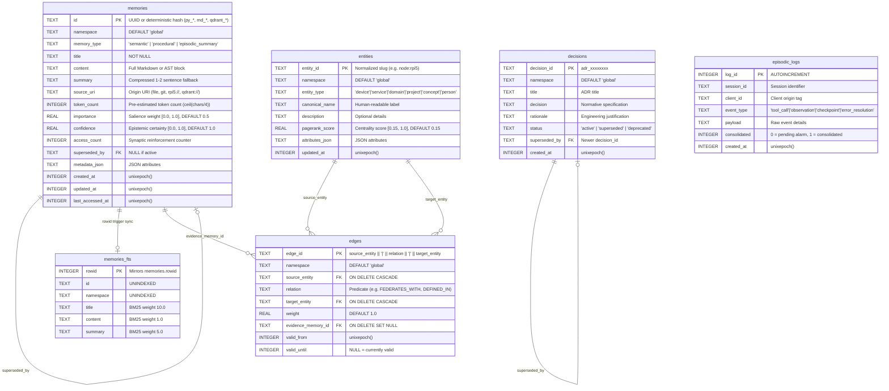
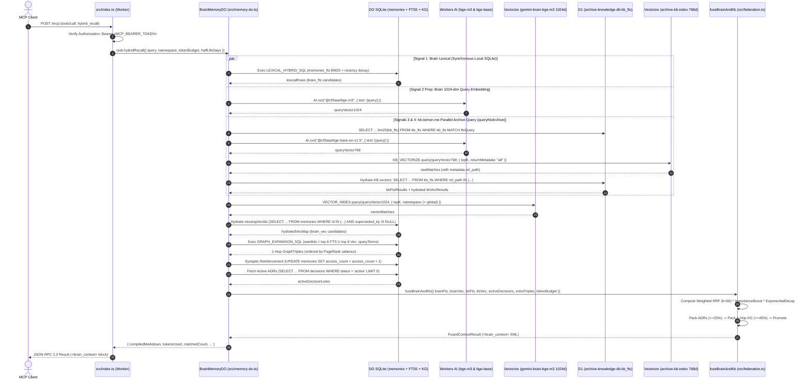
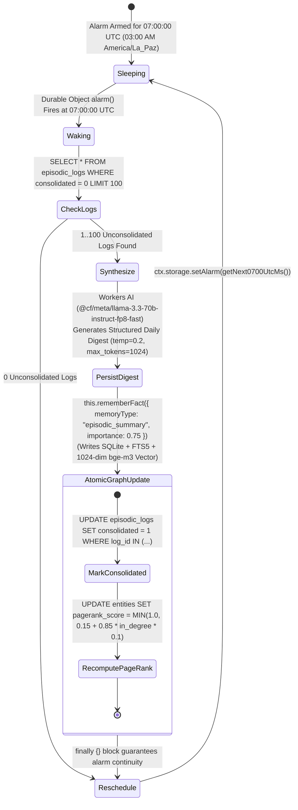
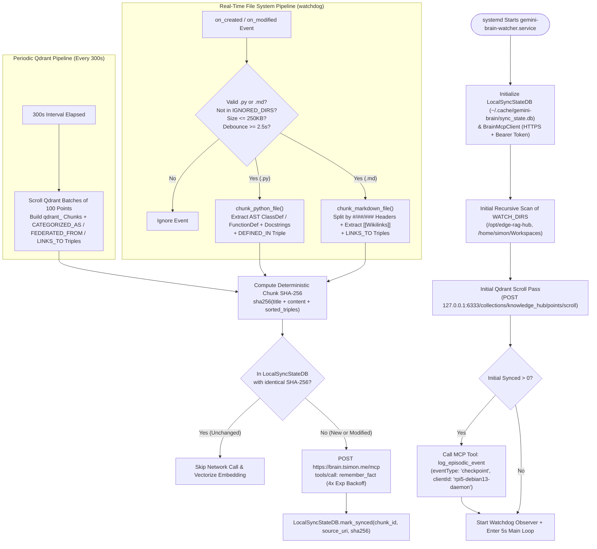

<div align="center">

# 🧠 Gemini Brain (`brain.tsimon.me`)

### **Federated Cross-Client Semantic Memory, Knowledge Graph & Context Compiler MCP Server**

[](https://brain.tsimon.me/server-card)
[](https://brain.tsimon.me/.well-known/mcp/server-card.json)
[](./wrangler.jsonc)
[_%2B_bge--base_(768d)-8B5CF6?style=for-the-badge&logo=cloudflare&logoColor=white)](./src/federation.ts)
[](./src/federation.ts)
[](./src/memory-do.ts)
[](./rpi-sync/brain_watcher.py)
[](./tsconfig.json)

**A stateful, globally distributed cognitive layer hosted on the Cloudflare Edge that unifies Google Antigravity, Gemini CLI, the Gemini Web App, and a Raspberry Pi 5 Home Lab into a single persistent memory brain.**

[Layman's Architecture](#-part-i-architecture--how-it-works-in-laymans-terms) •
[How to Use & Schedules](#-part-ii-how-to-use-it-laymans-guide-modules-roles--schedules) •
[Technical Deep-Dive](#-part-iii-complete-technical-architecture--workflows) •
[SysAdmin Guide](#-1-system-administrator-guide-linux--windows--operations) •
[Cloud Engineer Guide](#-2-cloud-engineer-guide-cloudflare-edge--iac--cicd) •
[Context Engineer Guide](#-3-context-engineer-guide-cognitive-math--token-packing)

</div>

---

## 📑 Table of Contents

- [Part I: Architecture & How It Works (In Layman's Terms)](#-part-i-architecture--how-it-works-in-laymans-terms)
  - [1. The Problem: Why AI Assistants Have "Amnesia"](#1-the-problem-why-ai-assistants-have-amnesia)
  - [2. The Solution: One Shared "Digital Brain" on the Internet Edge](#2-the-solution-one-shared-digital-brain-on-the-internet-edge)
  - [3. The Four Memory Vaults Inside the Brain](#3-the-four-memory-vaults-inside-the-brain)
  - [4. Three Knowledge Worlds United into One (Federation)](#4-three-knowledge-worlds-united-into-one-federation)
  - [5. How the Brain Finds Answers in ~300 Milliseconds (4-Way Search)](#5-how-the-brain-finds-answers-in-300-milliseconds-4-way-search)
  - [6. Packing the Suitcase: Token Budgeting (`<brain_context>`)](#6-packing-the-suitcase-token-budgeting-brain_context)
  - [7. How the Brain "Sleeps" at 3:00 AM (The Nocturnal Consolidation Cycle)](#7-how-the-brain-sleeps-at-300-am-the-nocturnal-consolidation-cycle)
- [Part II: How to Use It (Layman's Guide, Modules, Roles & Schedules)](#-part-ii-how-to-use-it-laymans-guide-modules-roles--schedules)
  - [1. Using the Brain in Google Antigravity & Gemini CLI (Automatic Mode)](#1-using-the-brain-in-google-antigravity--gemini-cli-automatic-mode)
  - [2. Using the Brain in the Gemini Web App (3-Step Bridge Mode)](#2-using-the-brain-in-the-gemini-web-app-3-step-bridge-mode)
  - [3. Using the Brain on Your Raspberry Pi 5 (Hands-Free Auto-Sync)](#3-using-the-brain-on-your-raspberry-pi-5-hands-free-auto-sync)
  - [4. Running a One-Command Health Check](#4-running-a-one-command-health-check)
  - [5. Every Module's Role, Functions, and Schedule (Plain-English Reference)](#5-every-modules-role-functions-and-schedule-plain-english-reference)
- [Part III: Complete Technical Architecture & Workflows](#-part-iii-complete-technical-architecture--workflows)
  - [1. Repository Structure](#1-repository-structure)
  - [2. End-to-End Distributed System Topology](#2-end-to-end-distributed-system-topology)
  - [3. Technical Deep-Dive by Module](#3-technical-deep-dive-by-module)
    - [Module A: `src/index.ts` — Stateless Streamable HTTP MCP v2 Gateway](#module-a-srcindexts--stateless-streamable-http-mcp-v2-gateway)
    - [Module B: `src/schema.ts` — Embedded SQLite Relational, FTS5 & Property Graph Schema](#module-b-srcschemats--embedded-sqlite-relational-fts5--property-graph-schema)
    - [Module C: `src/memory-do.ts` — `BrainMemoryDO` Stateful Durable Object & Alarm Engine](#module-c-srcmemory-dots--brainmemorydo-stateful-durable-object--alarm-engine)
    - [Module D: `src/federation.ts` — 4-Way Weighted RRF, D1 Hydration & Context Compiler](#module-d-srcfederationts--4-way-weighted-rrf-d1-hydration--context-compiler)
    - [Module E: `rpi-sync/brain_watcher.py` — Edge AST/Markdown Chunker & Qdrant Federator](#module-e-rpi-syncbrain_watcherpy--edge-astmarkdown-chunker--qdrant-federator)
    - [Module F: `.github/workflows/deploy.yml` & `test_brain_mcp.py` — CI/CD & E2E Verification](#module-f-githubworkflowsdeployyml--test_brain_mcppy--cicd--e2e-verification)
  - [4. Complete Technical Workflow Sequence Schemas](#4-complete-technical-workflow-sequence-schemas)
    - [Workflow 1: `hybrid_recall` (4-Way Parallel Federation & Token Compilation)](#workflow-1-hybrid_recall-4-way-parallel-federation--token-compilation)
    - [Workflow 2: `remember_fact` (Dual SQLite + Vectorize + Knowledge Graph Upsert)](#workflow-2-remember_fact-dual-sqlite--vectorize--knowledge-graph-upsert)
    - [Workflow 3: Nocturnal `07:00 UTC` Consolidation Alarm (`alarm()`)](#workflow-3-nocturnal-0700-utc-consolidation-alarm-alarm)
    - [Workflow 4: Raspberry Pi 5 Edge File & Qdrant Federation Pipeline](#workflow-4-raspberry-pi-5-edge-file--qdrant-federation-pipeline)
- [Part IV: Persona-Specific Engineering Manuals](#-part-iv-persona-specific-engineering-manuals)
  - [1. System Administrator Guide (Linux / Windows / Operations)](#-1-system-administrator-guide-linux--windows--operations)
  - [2. Cloud Engineer Guide (Cloudflare Edge / IaC / CI-CD)](#-2-cloud-engineer-guide-cloudflare-edge--iac--cicd)
  - [3. Context Engineer Guide (Cognitive Math & Token Packing)](#-3-context-engineer-guide-cognitive-math--token-packing)

---

# 🌍 Part I: Architecture & How It Works (In Layman's Terms)

## 1. The Problem: Why AI Assistants Have "Amnesia"

When you work with AI assistants across different tools—writing code in **Google Antigravity** on your Windows 11 PC, running commands in the **Gemini CLI**, brainstorming architecture in the **Gemini Web App**, or running scripts on your **Raspberry Pi 5**—each tool normally lives in its own isolated bubble:

- **Every new chat starts from zero.** If you spend two hours solving a tricky firewall bug in your code editor, your terminal or web browser knows nothing about it five minutes later.
- **Important rules get forgotten.** You might tell an AI *"Always use port 51820 for WireGuard"*, only for another chat session next week to suggest a completely different port.
- **Searching your own files is fragmented.** Some of your knowledge lives in active code files, some in Obsidian Markdown notes on your Raspberry Pi, and thousands of historical documents, emails, and IT records live in your cloud archive (`kb.tsimon.me`).
- **Dumping everything into a prompt breaks the AI.** AI models have a "working memory limit" (called a **context window**). If you paste 50 pages of raw notes into a chat, the AI gets overwhelmed, slows down, and misses key details.

---

## 2. The Solution: One Shared "Digital Brain" on the Internet Edge

**Gemini Brain (`https://brain.tsimon.me/mcp`)** solves AI amnesia by acting as a **central, permanent, super-fast librarian** on the internet (hosted on Cloudflare's global network).

Instead of each AI app keeping memories locked inside its own chat history, all of your tools connect to this single shared Brain using an industry-standard plug called **MCP (Model Context Protocol)**:



---

## 3. The Four Memory Vaults Inside the Brain

Just like a human brain stores different kinds of information in different ways, **Gemini Brain** organizes your knowledge into **four distinct vaults**:

| Memory Vault | Everyday Analogy | What It Stores | How the Brain Uses It |
| :--- | :--- | :--- | :--- |
| **1. The Rulebook**<br/>*(Architecture Decision Records / `decisions`)* | **Constitutional Laws** | Strict, non-negotiable engineering decisions (and why you made them). | Whenever you ask the Brain for context, it pins active rules **at the very top** of the answer so no AI assistant ever breaks your rules. If a rule changes later, the new rule marks the old one as "superseded" (retired). |
| **2. The Encyclopedia & Cookbook**<br/>*(Semantic & Procedural `memories`)* | **Reference Books & Recipe Cards** | Permanent facts, server configurations, documentation ("Semantic"), and actual code functions/scripts ("Procedural"). | Searched by both **exact words** and **overall meaning** whenever you ask a question. Memories you use often get a "popularity counter" boost (synaptic reinforcement). |
| **3. The Mind-Map**<br/>*(Knowledge Graph `entities` & `edges`)* | **A Detective's String Board** | Connections between things in the form of `(Subject) --> [RELATION] --> (Object)`. For example: `(Raspberry Pi 5) --> [EXPOSES_PORT] --> (WireGuard UDP 51820)`. | When the Brain finds a relevant fact, it automatically follows the strings **one step outward ("1-hop")** to pull in connected equipment, domains, or files you didn't even think to ask for. |
| **4. The Daily Scratchpad**<br/>*(Episodic Logs `episodic_logs`)* | **A Daytime Sticky-Note Pad** | Quick, raw notes jotted down during coding or troubleshooting (bugs fixed, checkpoints reached, observations). | Held temporarily during the day so you don't clutter the Encyclopedia. Every night at **3:00 AM**, the Brain wakes up, reads all sticky notes from the day, writes one clean summary page into the Encyclopedia, and checks off the sticky notes. |

---

## 4. Three Knowledge Worlds United into One (Federation)

What makes Gemini Brain uniquely powerful is **Federation**—meaning you only ask **one question**, and the Brain searches across **three different worlds of data** at the exact same time:

1. **World 1 — The Active Engineering Brain (`brain.tsimon.me`):** Everything you and your AI assistants have explicitly taught the Brain (facts, rules, mind-map relationships, and nightly summaries).
2. **World 2 — The Historical Deep Archive (`kb.tsimon.me`):** Your massive existing archive database containing **14,422+ records** across company documents, emails, spreadsheets, scripts, and IT Glue CMDB records. Because both live on your Cloudflare account, `brain.tsimon.me` talks directly to `kb.tsimon.me` internally with **zero internet travel time**.
3. **World 3 — Your Raspberry Pi 5 Home Lab (`192.168.1.14`):** A background helper program (`brain_watcher.py`) runs 24/7 on your Raspberry Pi 5. Whenever you edit a Python `.py` file or Markdown `.md` note on the Pi—or add items to your local **Qdrant** database (`knowledge_hub`)—the Pi automatically slices it into bite-sized pieces and uploads only what changed to `brain.tsimon.me`.

---

## 5. How the Brain Finds Answers in ~300 Milliseconds (4-Way Search)

If you only search by **exact words** (like Ctrl+F), searching for *"firewall port"* won't find a note that says *"UFW allows UDP 51820"*.
Conversely, if you only search by **AI meaning (vectors)**, searching for an exact error code or hostname like `adr_782e50f6` or `sql.md` often returns fuzzy, approximate matches.

Gemini Brain solves this by running **four search engines in parallel** on every single question:

1. **`[BRAIN]` Word Search (`brain_fts`):** Looks for exact words, filenames, IPs, and identifiers inside your Active Brain.
2. **`[BRAIN]` Meaning Search (`brain_vec`):** Converts your question into a 1,024-number "meaning fingerprint" (using the `@cf/baai/bge-m3` AI model) to find conceptually related facts in your Active Brain, plus 1-hop Mind-Map connections.
3. **`[KB]` Archive Word Search (`kb_fts`):** Looks for exact words, client codes, and document titles across the 14,422+ records in `kb.tsimon.me`.
4. **`[KB]` Archive Meaning Search (`kb_vec`):** Converts your question into a 768-number "meaning fingerprint" (using `@cf/baai/bge-base-en-v1.5`) to find conceptually related historical documents in `kb.tsimon.me`.

### How the 4 Judges Vote (Reciprocal Rank Fusion)
Once all 4 search engines return their top lists, the Brain uses a voting formula called **Reciprocal Rank Fusion (RRF)**:
- If a document appears near the top of **both** Word Search and Meaning Search, its score skyrockets.
- Newer memories in the Active Brain get a **freshness boost** (older temporary memories gently fade unless they are marked high-importance, while curated archive documents in `kb.tsimon.me` never fade).
- To guarantee fairness, the **#1 top match from each of the 4 search engines** is given a VIP pass to the front of the line so neither the Active Brain nor the Historical Archive can drown the other out.

---

## 6. Packing the Suitcase: Token Budgeting (`<brain_context>`)

After ranking the best results, the Brain does **not** just dump everything back into your AI chat. Instead, it acts like an expert traveler packing a suitcase with a strict weight limit (by default, **1,500 tokens**, which is roughly 1,100 words, adjustable from `200` to `8,000` tokens):



If a result near the end is too big to fit in the remaining space, the Brain automatically switches to a **2-sentence condensed summary** of that result so you still get the key takeaway without exceeding your budget!

---

## 7. How the Brain "Sleeps" at 3:00 AM (The Nocturnal Consolidation Cycle)

Human brains don't keep every raw sensory detail from the day forever; during deep sleep, the hippocampus replays the day's events and distills important lessons into the neocortex.

**Gemini Brain has an actual biological-style sleep cycle built into its cloud hardware:**
- Every night at **03:00 AM Bolivia Time (`America/La_Paz` / `07:00:00 UTC`)**, an internal alarm clock (`alarm()`) inside the Cloudflare Durable Object wakes the Brain up automatically—even if all your computers are turned off.
- **Step 1 (Read the Scratchpad):** It gathers up to 100 raw notes (`episodic_logs`) recorded during the day across your PC, CLI, and Raspberry Pi.
- **Step 2 (Dream & Synthesize):** It sends those raw notes to Meta's **Llama 3.3 70B Instruct** AI model (`@cf/meta/llama-3.3-70b-instruct-fp8-fast`) with instructions to remove duplicates, resolve contradictions, and write a clean, structured **Daily Consolidated Episodic Digest** containing:
  1. A concise 2-sentence summary of the day's engineering work.
  2. Key technical facts and architectural observations.
  3. Resolved errors and debugging lessons.
- **Step 3 (Store Long-Term Wisdom):** It saves that digest as a permanent searchable memory (`episodic_summary`), generates its 1024-dim vector fingerprint, and marks the raw sticky notes as consolidated (`consolidated = 1`).
- **Step 4 (Re-weight the Mind-Map):** It recalculates the **PageRank centrality score** of every node in your Knowledge Graph—so equipment, services, and concepts that have the most connections pointing to them naturally gain higher priority in future searches.
- **Step 5 (Reset Alarm):** Finally, it sets its own alarm clock for 03:00 AM the next night and goes back to sleep.

---

# 🛠️ Part II: How to Use It (Layman's Guide, Modules, Roles & Schedules)

## 1. Using the Brain in Google Antigravity & Gemini CLI (Automatic Mode)

Because `https://brain.tsimon.me/mcp` is registered in your local configuration files (`C:\Users\simon\.gemini\settings.json` and `C:\Users\simon\.gemini\config\mcp_config.json`), **Google Antigravity** and **Gemini CLI** can talk to the Brain directly. You don't need to write code—just ask in plain English!

### 🔍 Action A: Recall Context (`hybrid_recall`)
Ask your AI to search your Brain and Archive before starting a task:
> *"Use `hybrid_recall` to recall everything we have on Digilock Veeam backup retention and RPi5 firewall rules with a tokenBudget of 2500."*

### 💡 Action B: Teach the Brain a Fact & Mind-Map Connection (`remember_fact`)
Tell your AI to permanently save a configuration, guide, or code snippet:
> *"Remember this fact in the `homelab` namespace with importance 0.9: 'RPi5 WireGuard VPN listens on UDP 51820', and link triple `node:rpi5` (`Raspberry Pi 5`) `EXPOSES_PORT` `port:udp-51820` (`WireGuard UDP 51820`)."*

### 📜 Action C: Set an Unbreakable Engineering Rule (`log_decision`)
Record an Architecture Decision Record (ADR) so future AI sessions always obey it:
> *"Log an ADR in the `global` namespace titled 'ADR-04: Canonical D1 Hydration Key' stating that `archive-kb-index` vectors must always hydrate against `kb_fts` using `rel_path` rather than numeric `id`."*
*(Tip: If this replaces an older rule, just say *"superseding `adr_782e50f6`"*, and the Brain will automatically retire the old rule!)*

### 📝 Action D: Jot Down a Daytime Progress Note (`log_episodic_event`)
Save a quick checkpoint during debugging so the 3:00 AM sleep cycle includes it:
> *"Log an episodic `checkpoint` event for this session summarizing our D1 + Vectorize federation work."*

### 🏁 Action E: End-of-Session Wrap-Up (`checkpoint-session` Prompt)
At the end of a coding session, trigger the built-in `checkpoint-session` prompt (or simply ask):
> *"Run the `checkpoint-session` workflow for project `tsimon.me` to log an episodic checkpoint and extract permanent facts and ADRs from our session today."*

---

## 2. Using the Brain in the Gemini Web App (3-Step Bridge Mode)

Because the consumer **Gemini Web App** (`gemini.google.com`) runs inside a security-sandboxed web browser tab, it cannot directly attach your private `MCP_BEARER_TOKEN` to live background requests the way your IDE or CLI does.

Instead, you use a simple **3-Step Copy/Paste Bridge** between PowerShell on your PC and the Gemini Web App (using the tag `"clientId": "gemini-web-architect"`):



### Step 1: Copy Context from the Brain to Your Clipboard
Run this in PowerShell inside [c:\Users\simon\Workspaces\gemini-brain](file:///c:/Users/simon/Workspaces/gemini-brain) to fetch context and copy it straight to your Windows clipboard, then press `Ctrl+V` in the Gemini Web App:

```powershell
Set-Location "C:\Users\simon\Workspaces\gemini-brain"
$token = (Get-Content .\.dev.vars | Where-Object { $_ -match "^MCP_BEARER_TOKEN=" }) -replace "^MCP_BEARER_TOKEN=", ""
$headers = @{
    "Authorization" = "Bearer $token"
    "Content-Type"  = "application/json"
    "Accept"        = "application/json, text/event-stream"
}
$body = @{
    jsonrpc = "2.0"
    id      = 1
    method  = "tools/call"
    params  = @{
        name      = "hybrid_recall"
        arguments = @{
            query       = "Cloudflare Service Bindings and RPi5 edge telemetry architecture"
            namespace   = "global"
            tokenBudget = 2000
        }
    }
} | ConvertTo-Json -Depth 5

$resp = Invoke-RestMethod -Uri "https://brain.tsimon.me/mcp" -Method Post -Headers $headers -Body $body
$resp.result.content[0].text | Set-Clipboard
Write-Host "Copied <brain_context> to clipboard! Paste (Ctrl+V) into Gemini Web." -ForegroundColor Green
```

### Step 2: Brainstorm in Gemini Web & Ask for a Checkpoint Snippet
While chatting in the Gemini Web App, tell it:
- *"Generate a `gemini-web-architect` checkpoint for this architecture."*
- *"Draft a `log_decision` PowerShell payload for our choice here."*
- *"Format these specs as a `remember_fact` call for `brain.tsimon.me`."*

### Step 3: Paste the Generated Snippet Back into PowerShell
Run the PowerShell block Gemini Web gives you to save your new rule or fact permanently:

```powershell
$body = @{
    jsonrpc = "2.0"
    id      = 2
    method  = "tools/call"
    params  = @{
        name      = "log_decision"
        arguments = @{
            namespace = "global"
            title     = "Federate kb.tsimon.me with brain.tsimon.me at the Edge"
            decision  = "Bind D1 archive-knowledge-db and archive-kb-index directly to gemini-brain and merge via 4-way RRF."
            rationale = "Eliminates public HTTP round-trips and unifies token budgeting."
        }
    }
} | ConvertTo-Json -Depth 5

Invoke-RestMethod -Uri "https://brain.tsimon.me/mcp" -Method Post -Headers $headers -Body $body
```

---

## 3. Using the Brain on Your Raspberry Pi 5 (Hands-Free Auto-Sync)

On your Raspberry Pi 5 (`ssh pi` -> `192.168.1.14`), the Brain works **completely hands-free** in the background via a Linux system service (`gemini-brain-watcher.service`):

- **Save a Python file (`.py`):** Within **2.5 seconds**, the Pi reads every class and function (`def`), extracts its description (docstring), creates a Mind-Map link showing which file defines that function, and sends it to `brain.tsimon.me`.
- **Save a Markdown note (`.md`):** Within **2.5 seconds**, the Pi splits your note by headings (`#`, `##`, `###`), finds any Obsidian-style `[[Wikilinks]]`, turns them into Mind-Map links, and sends them to `brain.tsimon.me`.
- **Update local Qdrant (`knowledge_hub`):** Every **5 minutes**, the Pi checks your local Qdrant vector database (`http://127.0.0.1:6333`) and syncs any new points up to `brain.tsimon.me`.
- **Smart Deduplication:** The Pi keeps a tiny local checklist (`~/.cache/gemini-brain/sync_state.db`) of digital fingerprints (`SHA-256`). If a section of a file hasn't changed since last time, it skips it so it never wastes bandwidth or AI credits!

**Useful everyday commands for your Pi:**
```bash
# Check if the Pi watcher is running and see the last 25 sync messages
ssh pi "systemctl status gemini-brain-watcher.service && journalctl -u gemini-brain-watcher.service -n 25 --no-pager"

# Restart the watcher (forces an immediate directory scan + Qdrant sync)
ssh pi "systemctl restart gemini-brain-watcher.service"
```

---

## 4. Running a One-Command Health Check

Whenever you want to verify that the Brain, the Knowledge Graph, and the `kb.tsimon.me` Archive are all healthy and talking to each other, run the included verification script [test_brain_mcp.py](file:///c:/Users/simon/Workspaces/gemini-brain/test_brain_mcp.py):

```powershell
Set-Location "C:\Users\simon\Workspaces\gemini-brain"
python .\test_brain_mcp.py
```

Or inspect the Brain's public ID card (`/server-card`) directly from PowerShell:
```powershell
Set-Location "C:\Users\simon\Workspaces\gemini-brain"
$token = (Get-Content .\.dev.vars | Where-Object { $_ -match "^MCP_BEARER_TOKEN=" }) -replace "^MCP_BEARER_TOKEN=", ""
Invoke-RestMethod -Uri "https://brain.tsimon.me/server-card" -Headers @{ Authorization = "Bearer $token" } | ConvertTo-Json -Depth 5
```

---

## 5. Every Module's Role, Functions, and Schedule (Plain-English Reference)

Below is the complete, unomitted inventory of **every module in the system**, **what role it plays**, **every function it performs**, and **when it runs**:

| Module / File | Plain-English Role | Every Function Inside & What It Does | Exact Schedule / When It Runs |
| :--- | :--- | :--- | :--- |
| **[src/index.ts](file:///c:/Users/simon/Workspaces/gemini-brain/src/index.ts)**<br/>*The Front Door & Receptionist* | Welcomes incoming connections at `brain.tsimon.me`, checks their security badge (`MCP_BEARER_TOKEN`), shows the public menu (`/server-card`), and directs requests to your personal Brain vault. | • `fetch()`: Checks security token, serves `/server-card` discovery JSON, or hands off to MCP.<br/>• `createBrainMcpServer()`: Registers the **4 Tools** (`hybrid_recall`, `log_decision`, `log_episodic_event`, `remember_fact`), **2 Read-Only Info Pages (Resources)** (`brain://decisions/active`, `brain://telemetry/status`), and **1 Workflow Shortcut (Prompt)** (`checkpoint-session`).<br/>• `getBrainStub()`: Connects to your single master Brain instance (`"thomas-simon-primary-brain"`). | **On-Demand (Real-Time):** Wakes up instantly (<1 millisecond) whenever any tool or user sends an HTTP request to `brain.tsimon.me`. |
| **[src/memory-do.ts](file:///c:/Users/simon/Workspaces/gemini-brain/src/memory-do.ts)**<br/>*The Master Librarian & Nightly Dreamer (`BrainMemoryDO`)* | Your personal, permanent Brain vault on Cloudflare. Holds the SQLite database, coordinates AI embeddings, runs the 4-way search, and runs the 3:00 AM nightly sleep cycle. | • `constructor()`: Sets up all database tables safely before taking requests and checks that the 3:00 AM alarm is set.<br/>• `getNext0700UtcMs()` & `ensureAlarmScheduled()`: Calculates the exact timestamp for the next 03:00 AM Bolivia (`07:00 UTC`) alarm.<br/>• `rememberFact()`: Turns a new fact into a 1024-number AI vector, saves the text and Mind-Map links in SQLite, and saves the vector in Cloudflare Vectorize.<br/>• `hybridRecall()`: Coordinates the 4-way search across the Brain and `kb.tsimon.me`, expands 1-hop Mind-Map neighbors, increments the popularity counter (`access_count`) of recalled memories, grabs active Rules (ADRs), and returns the packed `<brain_context>`.<br/>• `logDecision()`: Saves a new Architecture Rule (ADR) and optionally marks an older rule as superseded.<br/>• `logEpisodicEvent()`: Adds a raw daytime note to the scratchpad and ensures the 3:00 AM alarm is armed.<br/>• `getActiveDecisions()`: Formats all active Rules into a clean Markdown document.<br/>• `getNamespaceStats()`: Counts total active memories, Mind-Map nodes/links, pending scratchpad notes, and reports the next alarm time.<br/>• `alarm()`: **The 3:00 AM Sleep Cycle**—summarizes up to 100 raw daytime notes using `Llama 3.3 70B`, saves the daily digest, updates Mind-Map PageRank scores, and re-arms the alarm for tomorrow. | • **On-Demand (Real-Time):** Whenever `src/index.ts` routes a tool or resource call to it.<br/>• **Scheduled Daily at `03:00:00 AM America/La_Paz` (`07:00:00 UTC`):** The `alarm()` method wakes up automatically every 24 hours. |
| **[src/federation.ts](file:///c:/Users/simon/Workspaces/gemini-brain/src/federation.ts)**<br/>*The Archive Bridge & Suitcase Packer* | Searches the 14,422-record `kb.tsimon.me` archive, merges all 4 search lists using the RRF voting formula, and packs the final `<brain_context>` within your token budget. | • `estimateTokens()`: Estimates token count (`characters ÷ 4`).<br/>• `buildSafeFts5Query()`: Cleans up natural-language questions (removes punctuation and filler words like *"the"*, *"and"*, *"what"*) so SQLite word search never crashes.<br/>• `queryKbArchive()`: Runs word search on `kb.tsimon.me`'s D1 database (`kb_fts`) and 768-number meaning search on `archive-kb-index` at the same time, then matches vectors back to full document text using file paths (`rel_path`).<br/>• `KbFederationService.searchKb()`: A direct internal cloud plug (`WorkerEntrypoint`) allowing other Cloudflare Workers in your account to search `kb.tsimon.me` with zero network delay.<br/>• `fuseBrainAndKb()`: Combines all 4 search result lists, applies freshness and importance boosts, puts Rules and Mind-Map links first, promotes the #1 winner of each search engine, and packs the `<brain_context>` suitcase. | **On-Demand (Real-Time):** Runs in parallel inside every `hybrid_recall` request (or when another Cloudflare Worker calls `KbFederationService`). |
| **[src/schema.ts](file:///c:/Users/simon/Workspaces/gemini-brain/src/schema.ts)**<br/>*The Database Blueprint & Search Formulas* | Defines the 6 database tables inside the Brain, automatic sync triggers, and the SQL math for word search and Mind-Map traversal. | • `SCHEMA_DDL`: Creates the 6 tables (`memories`, `memories_fts`, `entities`, `edges`, `decisions`, `episodic_logs`) and **3 automatic triggers** (`trg_memories_ai`, `trg_memories_ad`, `trg_memories_au`) that keep the word-search index in sync whenever a memory is added, updated, or retired.<br/>• `LEXICAL_HYBRID_SQL`: The SQL query that scores exact word matches (giving `10x` weight to titles and `5x` to summaries) and calculates age decay.<br/>• `GRAPH_EXPANSION_SQL`: The SQL query that walks 1 step outward across Mind-Map connections from the top recalled memories and ranks them by `pagerank_score`. | • **On Cold Start:** `SCHEMA_DDL` runs once when `BrainMemoryDO` wakes up.<br/>• **On Every Write:** Database triggers run automatically inside SQLite.<br/>• **On Every Recall:** `LEXICAL_HYBRID_SQL` and `GRAPH_EXPANSION_SQL` run during `hybrid_recall`. |
| **[rpi-sync/brain_watcher.py](file:///c:/Users/simon/Workspaces/gemini-brain/rpi-sync/brain_watcher.py)**<br/>*The Raspberry Pi 5 Home Lab Courier* | Watches your Raspberry Pi 5 folders and local Qdrant database 24/7, slices Python code and Markdown notes into smart chunks, and uploads changes to `brain.tsimon.me`. | • `_load_qdrant_credentials()`: Reads your Qdrant API key and collection name from environment variables or `/opt/edge-rag-hub/.env`.<br/>• `LocalSyncStateDB`: Manages the local SQLite checklist (`~/.cache/gemini-brain/sync_state.db`) so unchanged chunks are never uploaded twice.<br/>• `chunk_python_file()`: Uses Python's code parser (`ast`) to extract each class and function + docstring and links `DEFINED_IN` Mind-Map triples.<br/>• `chunk_markdown_file()`: Splits Markdown notes by `#`, `##`, `###` headers, extracts `[[Wikilinks]]`, and links `LINKS_TO` Mind-Map triples.<br/>• `BrainMcpClient.call_tool()`: Sends changes to `brain.tsimon.me/mcp` with automatic retry (up to 4 tries if the internet blips).<br/>• `QdrantBrainFederator.sync_collection()`: Scrolls through all items in your local RPi5 Qdrant (`knowledge_hub`) and uploads new/updated items to `brain.tsimon.me`.<br/>• `BrainSyncHandler`: Listens for file saves with a `2.5s` pause (debounce) so rapid Ctrl+S presses only trigger one upload.<br/>• `main()`: Runs the startup scan, starts the file watcher, and loops every 5 seconds to trigger the 5-minute Qdrant sync. | • **At Boot / Service Start:** Scans all watched folders (`/opt/edge-rag-hub`, `/home/simon/Workspaces`) + runs a full Qdrant scroll + logs a boot `checkpoint`.<br/>• **Real-Time (Event-Driven):** Triggers **2.5 seconds** after any `.py` or `.md` file is created or modified.<br/>• **Recurring Every 5 Minutes (`300s`):** Scrolls local Qdrant (`127.0.0.1:6333`) for any new points. |
| **[rpi-sync/gemini-brain-watcher.service](file:///c:/Users/simon/Workspaces/gemini-brain/rpi-sync/gemini-brain-watcher.service)** & **[install_rpi.sh](file:///c:/Users/simon/Workspaces/gemini-brain/rpi-sync/install_rpi.sh)**<br/>*The Pi Auto-Starter* | Installs and keeps `brain_watcher.py` running 24/7 on your Raspberry Pi 5, restarting it automatically if the Pi reboots or the script crashes. | • Creates the Python virtual environment (`.venv`), sets up `/etc/gemini-brain/watcher.env`, and registers the Linux `systemd` background service. | • **At Raspberry Pi Boot:** Starts automatically as soon as the network comes online (`network-online.target`).<br/>• **On Crash:** Restarts automatically after **10 seconds** (`RestartSec=10`). |
| **[.github/workflows/deploy.yml](file:///c:/Users/simon/Workspaces/gemini-brain/.github/workflows/deploy.yml)**<br/>*The Cloud Auto-Deployer* | Automatically checks your TypeScript code for errors, deploys updates to Cloudflare, and tests that `brain.tsimon.me/server-card` responds. | • Installs Node.js 22, runs `wrangler types` and `tsc --noEmit` (strict type checking), deploys via `cloudflare/wrangler-action@v3`, and curls `/server-card`. | **On Git Push to `main`** (whenever code files change; ignores `.md` and `rpi-sync/**` edits) or **On Manual Click** (`workflow_dispatch`). |
| **[test_brain_mcp.py](file:///c:/Users/simon/Workspaces/gemini-brain/test_brain_mcp.py)**<br/>*The Live Health Inspector* | Runs a 4-step live test against `brain.tsimon.me` to prove every part of the system works end-to-end. | • **Test 1:** Checks `/server-card`.<br/>• **Test 2:** Writes a test memory + Mind-Map link via `remember_fact`.<br/>• **Test 3:** Recalls that memory + 1-hop link via `hybrid_recall` and verifies token budget.<br/>• **Test 4:** Queries `kb.tsimon.me` via `hybrid_recall` and verifies both `[BRAIN]` and `[KB]` badges appear. | **On-Demand (Manual):** Run anytime from your terminal via `python test_brain_mcp.py`. |

### Master Schedule & Trigger Timeline

```mermaid
flowchart LR
    subgraph Realtime["⚡ Real-Time (< 500ms)"]
        RT1["MCP Tool Call<br/>(hybrid_recall, remember_fact,<br/>log_decision, log_episodic_event)"]
        RT2["SQLite FTS5 Triggers<br/>(Instant on INSERT/UPDATE/DELETE)"]
    end

    subgraph NearRealtime["⏱️ Near Real-Time (2.5s - 30s)"]
        NRT1["RPi5 File Edit (.py / .md)<br/>--> 2.5s Debounce --> AST/MD Chunk Sync"]
        NRT2["Git Push to main<br/>--> ~45s GitHub Actions Deploy"]
    end

    subgraph Periodic["🔄 Periodic (Every 5 Minutes / 300s)"]
        P1["RPi5 Qdrant Scroll<br/>(127.0.0.1:6333/collections/knowledge_hub)<br/>--> Syncs new vectors to BrainMemoryDO"]
    end

    subgraph Nocturnal["🌙 Daily Sleep Cycle (03:00 AM America/La_Paz / 07:00 UTC)"]
        N1["BrainMemoryDO.alarm() Wakes Up"]
        N2["Synthesizes <=100 episodic_logs<br/>via Llama 3.3 70B Instruct"]
        N3["Saves Daily Digest + Recomputes<br/>Knowledge Graph PageRank"]
    end

    Realtime --> NearRealtime --> Periodic --> Nocturnal
```



---

# ⚙️ Part III: Complete Technical Architecture & Workflows

## 1. Repository Structure

```text
gemini-brain/
├── .github/
│   └── workflows/
│       └── deploy.yml                  # CI/CD pipeline: Node 22, wrangler types, tsc, Wrangler deploy & smoke test
├── rpi-sync/
│   ├── brain_watcher.py                # RPi5 daemon: Python AST + Markdown/Wikilink chunker + Qdrant scroll federator
│   ├── gemini-brain-watcher.service    # systemd unit file (User=simon, Nice=10, RestartSec=10)
│   ├── install_rpi.sh                  # Automated RPi5 Debian 13 provisioning & systemd installer script
│   └── requirements.txt                # Python dependencies: httpx>=0.28.0, watchdog>=6.0.0
├── src/
│   ├── index.ts                        # Stateless Streamable HTTP MCP v2 server, Bearer auth & SEP-2127 discovery
│   ├── memory-do.ts                    # Stateful Durable Object (BrainMemoryDO): SQLite, Vectorize, KG & 07:00 UTC alarm
│   ├── federation.ts                   # 4-Way Weighted RRF, D1 kb_fts + 768-dim KB Vectorize hydration & token compiler
│   └── schema.ts                       # Embedded DO SQLite DDL (6 tables, 3 FTS5 triggers) & parameterized hybrid/KG SQL
├── package.json                        # @modelcontextprotocol/server ^2.4.0, agents ^0.33.0, zod ^4.2.0, wrangler ^4.14.0
├── tsconfig.json                       # ES2022 Bundler strict TypeScript configuration
├── wrangler.jsonc                      # Cloudflare bindings: BRAIN_DO, VECTOR_INDEX, KB_DB, KB_VECTORIZE, AI, vars
├── test_brain_mcp.py                   # 4-stage live E2E verification suite (Discovery, Write, Recall+KG, Federation)
└── README.md                           # Complete multi-level architecture & operational documentation
```

---

## 2. End-to-End Distributed System Topology

The diagram below illustrates the complete production architecture across client runtimes, the Cloudflare global network edge, stateful Durable Object storage, federated D1/Vectorize bindings, Workers AI inference models, and the Raspberry Pi 5 edge node:



---

## 3. Technical Deep-Dive by Module

### Module A: [src/index.ts](file:///c:/Users/simon/Workspaces/gemini-brain/src/index.ts) — Stateless Streamable HTTP MCP v2 Gateway

- **Runtime & Protocol:** Executes as a stateless Cloudflare Worker entry point implementing the Model Context Protocol (MCP) Streamable HTTP transport via `@modelcontextprotocol/server` (`^2.4.0`) and Cloudflare's `agents/mcp/server` (`createMcpHandler`).
- **Authentication Layer ([lines 276–285](file:///c:/Users/simon/Workspaces/gemini-brain/src/index.ts#L276-L285)):** When `env.MCP_BEARER_TOKEN` is configured, every incoming HTTP request is validated for an exact `Authorization: Bearer <token>` header match before reaching discovery or MCP handlers. Unauthenticated requests receive an immediate `HTTP 401 Unauthorized` JSON response.
- **SEP-2127 Static Discovery Card ([lines 287–303](file:///c:/Users/simon/Workspaces/gemini-brain/src/index.ts#L287-L303)):** Intercepts `GET` requests to `/server-card`, `/.well-known/ai-catalog.json`, and `/.well-known/mcp/server-card.json` to return zero-connection capability metadata (server name, version `1.1.0`, MCP endpoint URL, federated sources list, and registered tool names).
- **Singleton Durable Object Routing ([lines 21–25](file:///c:/Users/simon/Workspaces/gemini-brain/src/index.ts#L21-L25)):** Resolves the deterministic Durable Object ID `env.BRAIN_DO.idFromName("thomas-simon-primary-brain")` so all globally distributed MCP clients converge on a single strongly consistent SQLite state machine.
- **Alphabetical Tool Registration (`ADR-02` Compliance, [lines 27–184](file:///c:/Users/simon/Workspaces/gemini-brain/src/index.ts#L27-L184)):** Tools are registered in strict alphabetical order (`hybrid_recall`, `log_decision`, `log_episodic_event`, `remember_fact`) with Zod (`^4.2.0`) input schemas for deterministic prompt-cache prefix stability across LLM clients.
- **MCP Resources & Prompts ([lines 186–267](file:///c:/Users/simon/Workspaces/gemini-brain/src/index.ts#L186-L267)):**
  - `brain://decisions/active` (`text/markdown`): Calls `stub.getActiveDecisions("global")`.
  - `brain://telemetry/status` (`application/json`): Calls `stub.getNamespaceStats("global")`.
  - `checkpoint-session`: Parameterized prompt (`project`, `summary`) instructing the host agent to invoke `log_episodic_event` (`eventType: "checkpoint"`) followed by `remember_fact` and `log_decision`.

---

### Module B: [src/schema.ts](file:///c:/Users/simon/Workspaces/gemini-brain/src/schema.ts) — Embedded SQLite Relational, FTS5 & Property Graph Schema

`SCHEMA_DDL` ([lines 7–118](file:///c:/Users/simon/Workspaces/gemini-brain/src/schema.ts#L7-L118)) provisions **5 relational tables**, **1 FTS5 virtual table**, **6 secondary indexes**, and **3 synchronization triggers** inside the Durable Object's local SQLite engine:



#### Key SQL Mechanics in `src/schema.ts`:
1. **FTS5 Tokenizer & Trigger Invariant ([lines 32–60](file:///c:/Users/simon/Workspaces/gemini-brain/src/schema.ts#L32-L60)):**
   - `memories_fts` uses `tokenize='porter unicode61 remove_diacritics 2'` for morphological stemming and accent insensitivity.
   - `trg_memories_ai` (AFTER INSERT), `trg_memories_ad` (AFTER DELETE), and `trg_memories_au` (AFTER UPDATE) guarantee that **only active memories** (`NEW.superseded_by IS NULL`) exist in `memories_fts`. As soon as a memory is superseded, `trg_memories_au` deletes its `rowid` from `memories_fts` without re-inserting it.
2. **Materialized Lexical Hybrid Query (`LEXICAL_HYBRID_SQL`, [lines 131–163](file:///c:/Users/simon/Workspaces/gemini-brain/src/schema.ts#L131-L163)):**
   - Uses a `WITH fts_matches AS MATERIALIZED` CTE to evaluate `bm25(memories_fts, 0.0, 0.0, 10.0, 1.0, 5.0)` once over the top 100 FTS hits (negating SQLite's negative BM25 output so higher values indicate stronger relevance, weighting `title` at `10.0`, `summary` at `5.0`, and `content` at `1.0`).
   - Joins against `memories` filtered by `(?2 = 'global' OR m.namespace = ?2 OR m.namespace = 'global') AND m.superseded_by IS NULL` and computes exponential recency decay `EXP(-0.693147 * MAX(0, (?3 - m.updated_at)) / ?4)`.
3. **1-Hop Knowledge Graph Subgraph Expansion (`GRAPH_EXPANSION_SQL`, [lines 175–212](file:///c:/Users/simon/Workspaces/gemini-brain/src/schema.ts#L175-L212)):**
   - Builds a `seed_entities` CTE combining:
     - All `source_entity` and `target_entity` IDs linked to the top recalled `evidence_memory_id`s (`WHERE valid_until IS NULL`).
     - Any `entity_id` or `LOWER(canonical_name)` matching tokenized query terms (`length > 2`).
   - Expands all active edges incident to `seed_entities` within the target or `global` namespace and orders triples by `graph_salience = (s.pagerank_score + t.pagerank_score) * e.weight DESC`.

---

### Module C: [src/memory-do.ts](file:///c:/Users/simon/Workspaces/gemini-brain/src/memory-do.ts) — `BrainMemoryDO` Stateful Durable Object & Alarm Engine

`BrainMemoryDO` extends `DurableObject<Env>` and encapsulates all transactional state and scheduled background execution:

| Method | Lines | Technical Execution Details |
| :--- | :--- | :--- |
| `constructor(ctx, env)` | [L82–L93](file:///c:/Users/simon/Workspaces/gemini-brain/src/memory-do.ts#L82-L93) | Wraps `this.sql.exec(SCHEMA_DDL)` inside `ctx.blockConcurrencyWhile()` and `ctx.storage.transactionSync()` so schema migrations complete atomically before any RPC call is serviced, then invokes `ensureAlarmScheduled()`. |
| `rememberFact(input)` | [L125–L252](file:///c:/Users/simon/Workspaces/gemini-brain/src/memory-do.ts#L125-L252) | 1. Calls `env.AI.run("@cf/baai/bge-m3", { text: [title + "\n" + content] })` to generate a `1024-dim` float vector.<br/>2. Inside `ctx.storage.transactionSync()`, executes `INSERT INTO memories ... ON CONFLICT(id) DO UPDATE`, then iterates over `input.triples` to upsert `entities` (both subject and object) and `edges` (`edgeId = subjectId\|relation\|objectId`, resetting `valid_until = NULL`).<br/>3. Calls `env.VECTOR_INDEX.upsert()` with the `1024-dim` vector and metadata `{ namespace, title, memory_type }`. |
| `hybridRecall(params)` | [L261–L484](file:///c:/Users/simon/Workspaces/gemini-brain/src/memory-do.ts#L261-L484) | 1. Concurrently launches: (a) `@cf/baai/bge-m3` `1024-dim` query embedding, (b) `queryKbArchive()` (which itself runs D1 `kb_fts` + `@cf/baai/bge-base-en-v1.5` `768-dim` Vectorize in parallel), and (c) synchronous local SQLite `LEXICAL_HYBRID_SQL`.<br/>2. Queries `env.VECTOR_INDEX` (`gemini-brain-bge-m3`). When a specific namespace (e.g., `homelab`) is requested, queries **both** that namespace (`topK`) and `global` (`max(5, floor(topK/2))`) in parallel and deduplicates by ID.<br/>3. Hydrates any vector-only Brain matches missing from the FTS5 result set via `SELECT ... FROM memories WHERE id IN (SELECT value FROM json_each(?1)) AND superseded_by IS NULL`.<br/>4. Selects up to 10 seed Brain IDs (`top 6 FTS ∪ top 6 Vec`), executes `GRAPH_EXPANSION_SQL` (limit 15 triples), and performs **synaptic reinforcement** (`UPDATE memories SET access_count = access_count + 1, last_accessed_at = ?2`).<br/>5. Fetches up to 5 active ADRs from `decisions` and passes all signals to `fuseBrainAndKb()`. |
| `logDecision(input)` | [L489–L524](file:///c:/Users/simon/Workspaces/gemini-brain/src/memory-do.ts#L489-L524) | Generates `decisionId = adr_<8-hex-chars>`, inserts the active ADR into `decisions`, and if `supersedesDecisionId` is provided, atomically updates the older record to `status = 'superseded', superseded_by = decisionId`. |
| `logEpisodicEvent(input)` | [L529–L555](file:///c:/Users/simon/Workspaces/gemini-brain/src/memory-do.ts#L529-L555) | Inserts raw session telemetry into `episodic_logs` (`consolidated = 0`) with `RETURNING log_id` and verifies the next `07:00 UTC` alarm is scheduled. |
| `alarm()` | [L651–L719](file:///c:/Users/simon/Workspaces/gemini-brain/src/memory-do.ts#L651-L719) | Queries up to 100 unconsolidated rows (`WHERE consolidated = 0 ORDER BY created_at ASC LIMIT 100`), invokes `@cf/meta/llama-3.3-70b-instruct-fp8-fast` (`max_tokens: 1024, temperature: 0.2`), persists the resulting digest via `this.rememberFact({ memoryType: "episodic_summary", importance: 0.75 })`, marks the batch `consolidated = 1`, recomputes `entities.pagerank_score`, and reschedules `setAlarm(getNext0700UtcMs())` inside a `finally` block so the schedule never breaks even on transient AI errors. |

---

### Module D: [src/federation.ts](file:///c:/Users/simon/Workspaces/gemini-brain/src/federation.ts) — 4-Way Weighted RRF, D1 Hydration & Context Compiler

- **FTS5 Query Sanitization (`buildSafeFts5Query`, [lines 88–97](file:///c:/Users/simon/Workspaces/gemini-brain/src/federation.ts#L88-L97)):** Strips non-alphanumeric/path characters (`[^\p{L}\p{N}_.\-/]`), filters out 16 common English stopwords and tokens shorter than 2 characters, and wraps each remaining token in double quotes joined by `OR` (`"token1" OR "token2"`), preventing FTS5 syntax injection on punctuation or reserved keywords (`AND`, `NOT`, `NEAR`).
- **Concurrent `kb.tsimon.me` Federation (`queryKbArchive`, [lines 103–272](file:///c:/Users/simon/Workspaces/gemini-brain/src/federation.ts#L103-L272)):**
  - Executes D1 `kb_fts` BM25 search (`-1.0 * bm25(kb_fts, 1.0, 0.0, 4.0, 10.0, 3.0, 2.0, 3.0, 3.0, 2.0, 1.0)`) and Workers AI `@cf/baai/bge-base-en-v1.5` (`768-dim`) embedding + `KB_VECTORIZE.query()` concurrently via `Promise.all`.
  - **Canonical `rel_path` Hydration (`ADR-04`, [lines 197–233](file:///c:/Users/simon/Workspaces/gemini-brain/src/federation.ts#L197-L233)):** Extracts `metadata.rel_path` from each `archive-kb-index` vector match and executes a parameterized `SELECT ... substr(content, 1, 1600) AS content FROM kb_fts WHERE rel_path IN (?1, ?2, ...)` against D1 `KB_DB` so vector matches are hydrated with their full 1,600-character document body and organizational metadata (`client_code`, `organization_name`, `primary_theme`).
- **Zero-Latency Service Binding Entrypoint (`KbFederationService`, [lines 278–289](file:///c:/Users/simon/Workspaces/gemini-brain/src/federation.ts#L278-L289)):** Exports a `WorkerEntrypoint<Env>` class exposing `searchKb(params)` over Cloudflare's internal Cap'n Proto RPC bus.

---

### Module E: [rpi-sync/brain_watcher.py](file:///c:/Users/simon/Workspaces/gemini-brain/rpi-sync/brain_watcher.py) — Edge AST/Markdown Chunker & Qdrant Federator

Designed for Debian 13 (Trixie) on Raspberry Pi 5, `brain_watcher.py` implements three ingestion pipelines backed by a local SQLite idempotency cache:

1. **Local SHA-256 State Cache (`LocalSyncStateDB`, [lines 124–164](file:///c:/Users/simon/Workspaces/gemini-brain/rpi-sync/brain_watcher.py#L124-L164)):**
   - Stores `(chunk_id PRIMARY KEY, source_uri, content_sha256, synced_at)` in `~/.cache/gemini-brain/sync_state.db`.
   - Each `SemanticChunk` computes `sha256(f"{title}\n{content}\n{json.dumps(triples, sort_keys=True)}")`. If `is_unchanged(chunk_id, sha256)` returns `True`, no network call or Workers AI embedding is triggered.
2. **Python AST Semantic Chunker (`chunk_python_file`, [lines 183–232](file:///c:/Users/simon/Workspaces/gemini-brain/rpi-sync/brain_watcher.py#L183-L232)):**
   - Parses `.py` files using Python's built-in `ast.parse()`.
   - Iterates top-level `ast.FunctionDef`, `ast.AsyncFunctionDef`, and `ast.ClassDef` nodes.
   - Extracts exact source segments via `ast.get_source_segment()`, extracts the first docstring line as `summary`, generates deterministic ID `py_<sha256(namespace:rel_path:node.name)[:24]>`, sets `memory_type = "procedural"`, and emits the Knowledge Graph triple:
     `symbol:<rel_path>:<node.name> --[DEFINED_IN]--> file:<rel_path>`.
3. **Markdown Header & Obsidian Wikilink Chunker (`chunk_markdown_file`, [lines 235–294](file:///c:/Users/simon/Workspaces/gemini-brain/rpi-sync/brain_watcher.py#L235-L294)):**
   - Splits `.md` files along `^#{1,3}\s+(.+)$` boundaries (filtering out stub sections `< 40` chars).
   - Extracts up to 10 `[[Wikilink]]` targets per section using `WIKILINK_RE = re.compile(r"\[\[([^\]|#]+)(?:[|#][^\]]*)?\]\]")`.
   - Generates deterministic ID `md_<sha256(namespace:rel_path:heading)[:24]>`, sets `memory_type = "semantic"`, and emits Knowledge Graph triples:
     `doc:<file_stem> --[LINKS_TO]--> concept:<target_slug>`.
4. **Qdrant Collection Scroll Federator (`QdrantBrainFederator`, [lines 351–520](file:///c:/Users/simon/Workspaces/gemini-brain/rpi-sync/brain_watcher.py#L351-L520)):**
   - Paginates `POST http://127.0.0.1:6333/collections/knowledge_hub/points/scroll` (`limit: 100, with_payload: True, with_vector: False`).
   - Maps each Qdrant point to `chunk_id = qdrant_<point_id>` (`importance = 0.82`), classifies `memory_type` as `"procedural"` if the content contains fenced code blocks (` ``` `) or `"semantic"` otherwise, and links up to 10 triples per point (`CATEGORIZED_AS`, `FEDERATED_FROM` `service:rpi5-qdrant-knowledge-hub`, and any `LINKS_TO` wikilinks).

---

### Module F: [.github/workflows/deploy.yml](file:///c:/Users/simon/Workspaces/gemini-brain/.github/workflows/deploy.yml) & [test_brain_mcp.py](file:///c:/Users/simon/Workspaces/gemini-brain/test_brain_mcp.py) — CI/CD & E2E Verification

- **GitHub Actions CI/CD (`.github/workflows/deploy.yml`):**
  - Triggers on `push` to `main` (ignoring `**.md` and `rpi-sync/**`) or manual `workflow_dispatch`.
  - Enforces concurrency serialization (`group: cloudflare-deploy-${{ github.ref }}`, `cancel-in-progress: false`) so two simultaneous pushes never interleave Durable Object migrations.
  - Executes `npx wrangler types` -> `npx tsc --noEmit` -> `cloudflare/wrangler-action@v3` (`deploy`) -> live `/server-card` verification (gracefully handling Cloudflare Bot Fight Mode HTTP 403 challenges on GitHub Actions datacenter runner IPs).
- **Live Verification Suite (`test_brain_mcp.py`):**
  - Zero-dependency Python 3 test runner (`urllib.request`) supporting both `application/json` and `text/event-stream` (SSE) MCP responses.
  - Validates: (1) `/server-card` discovery, (2) `remember_fact` write + 1024-dim vector indexing, (3) `hybrid_recall` retrieval + 1-hop `FEDERATES_WITH` triple expansion + token budget enforcement, and (4) cross-source `[BRAIN]` + `[KB]` federation against `kb.tsimon.me`.

---

## 4. Complete Technical Workflow Sequence Schemas

### Workflow 1: `hybrid_recall` (4-Way Parallel Federation & Token Compilation)



---

### Workflow 2: `remember_fact` (Dual SQLite + Vectorize + Knowledge Graph Upsert)

```mermaid
sequenceDiagram
    autonumber
    actor Client as MCP Client / RPi5 Daemon
    participant Worker as src/index.ts
    participant DO as BrainMemoryDO
    participant AI as Workers AI (@cf/baai/bge-m3)
    participant SQL as DO SQLite + FTS5 Triggers
    participant Vec as Vectorize (gemini-brain-bge-m3)

    Client->>Worker: POST /mcp (tools/call: remember_fact)
    Worker->>DO: stub.rememberFact(input)
    DO->>DO: Normalize namespace, memoryType, id (UUID or deterministic), summary, tokenCount
    DO->>AI: AI.run("@cf/baai/bge-m3", { text: ["${title}\n${content}"] })
    AI-->>DO: 1024-dim dense float vector

    rect rgb(30, 41, 59)
        Note over DO,SQL: Atomic SQLite Transaction (ctx.storage.transactionSync)
        DO->>SQL: INSERT INTO memories ... ON CONFLICT(id) DO UPDATE
        SQL->>SQL: Trigger trg_memories_ai / trg_memories_au updates memories_fts
        loop For each triple in input.triples
            DO->>SQL: INSERT INTO entities (subjectId) ON CONFLICT DO UPDATE
            DO->>SQL: INSERT INTO entities (objectId) ON CONFLICT DO UPDATE
            DO->>SQL: INSERT INTO edges (subjectId|relation|objectId) ON CONFLICT DO UPDATE (valid_until = NULL)
        end
    end

    DO->>Vec: VECTOR_INDEX.upsert([{ id, values: vector1024, namespace, metadata }])
    Vec-->>DO: Upsert ACK
    DO-->>Worker: { id, tokenCount, indexedVectors: 1 }
    Worker-->>Client: JSON-RPC 2.0 Success
```



---

### Workflow 3: Nocturnal `07:00 UTC` Consolidation Alarm (`alarm()`)



---

### Workflow 4: Raspberry Pi 5 Edge File & Qdrant Federation Pipeline



---

# 🎓 Part IV: Persona-Specific Engineering Manuals

## 🖥️ 1. System Administrator Guide (Linux / Windows / Operations)

### 1.1 Raspberry Pi 5 (`192.168.1.14`, Debian 13 Trixie) Provisioning & Service Management

To install or update the edge sync daemon on the Raspberry Pi 5, clone the repository to `/opt/gemini-brain` and run [rpi-sync/install_rpi.sh](file:///c:/Users/simon/Workspaces/gemini-brain/rpi-sync/install_rpi.sh):

```bash
sudo git clone https://github.com/t0m-a/gemini-brain.git /opt/gemini-brain
cd /opt/gemini-brain/rpi-sync
chmod +x install_rpi.sh
./install_rpi.sh
```

The installer creates `/etc/gemini-brain/watcher.env` with `0600` (`root:root`) permissions and registers [gemini-brain-watcher.service](file:///c:/Users/simon/Workspaces/gemini-brain/rpi-sync/gemini-brain-watcher.service) (`Nice=10` CPU scheduling priority, `Restart=always`, `RestartSec=10`).

#### Complete Environment Variable Matrix (`/etc/gemini-brain/watcher.env`)

| Variable | Default Value | Description |
| :--- | :--- | :--- |
| `BRAIN_MCP_URL` | `https://brain.tsimon.me/mcp` | Target Streamable HTTP MCP endpoint. |
| `MCP_BEARER_TOKEN` | *(Required)* | Secret Bearer token matching Cloudflare Worker `MCP_BEARER_TOKEN`. |
| `WATCH_DIRS` | `/opt/edge-rag-hub,/home/simon/Workspaces` | Comma-separated list of directories recursively monitored by `watchdog`. |
| `BRAIN_NAMESPACE` | `homelab` | Target namespace in `BrainMemoryDO` for synced chunks. |
| `BRAIN_CLIENT_ID` | `rpi5-debian13-daemon` | Provenance identifier stamped on `log_episodic_event` calls. |
| `BRAIN_STATE_DB` | `~/.cache/gemini-brain/sync_state.db` | Local SQLite database tracking `chunk_id` and `content_sha256`. |
| `BRAIN_DEBOUNCE_SEC` | `2.5` | Minimum seconds between consecutive sync triggers for the same file path. |
| `BRAIN_MAX_FILE_BYTES` | `250000` | Maximum file size (250 KB) eligible for AST/Markdown parsing. |
| `QDRANT_URL` | `http://127.0.0.1:6333` | Local RPi5 Qdrant HTTP endpoint. |
| `QDRANT_API_KEY` | Auto-loaded from `/opt/edge-rag-hub/.env` | Qdrant API key (falls back to `QDRANT_ENV_FILE` if unset in environment). |
| `QDRANT_COLLECTION` | `knowledge_hub` | Qdrant collection scrolled for federation into `BrainMemoryDO`. |
| `QDRANT_ENV_FILE` | `/opt/edge-rag-hub/.env` | Fallback dotenv file read for `QDRANT_API_KEY` and `QDRANT_COLLECTION`. |
| `QDRANT_SYNC_INTERVAL_SEC` | `300.0` | Interval in seconds (5 minutes) between Qdrant collection scroll passes. |

#### Ignored Directories & Security Filters
`brain_watcher.py` automatically excludes:
- Directories: `.git`, `node_modules`, `.wrangler`, `__pycache__`, `.venv`, `venv`, `dist`, `build`, `.obsidian`, `qdrant_data`, `qdrant_config`, `fastembed_cache`, `cloudflared_data`.
- Sensitive files: Any path component starting with `.env`, any file ending in `.local.ps1`, and any filename containing `HUMAN_CONTEXT` (case-insensitive).

#### Day-2 Linux Administration Runbooks

```bash
# 1. View real-time daemon logs on RPi5
ssh pi "journalctl -u gemini-brain-watcher.service -f"

# 2. Inspect local SQLite sync cache statistics on RPi5
ssh pi "sqlite3 ~/.cache/gemini-brain/sync_state.db 'SELECT COUNT(*) AS total_synced, datetime(MAX(synced_at), \"unixepoch\") AS last_sync_utc FROM synced_chunks;'"

# 3. Force a complete re-embedding & re-sync of all watched files and Qdrant points
ssh pi "rm -f ~/.cache/gemini-brain/sync_state.db && sudo systemctl restart gemini-brain-watcher.service"
```

---

### 1.2 Windows 11 Workstation (`antigravity-win11`) MCP Client Configuration

Register the server in `C:\Users\simon\.gemini\settings.json` and `C:\Users\simon\.gemini\config\mcp_config.json`:

```json
{
  "mcpServers": {
    "gemini-brain": {
      "httpUrl": "https://brain.tsimon.me/mcp",
      "headers": {
        "Authorization": "Bearer <YOUR_MCP_BEARER_TOKEN>"
      }
    }
  }
}
```

### 1.3 Operational Troubleshooting Matrix

| Symptom / Error Code | Root Cause | Resolution |
| :--- | :--- | :--- |
| **`HTTP 401 Unauthorized`** | Missing or mismatched `Authorization: Bearer <token>` header. | Verify `MCP_BEARER_TOKEN` in local `.dev.vars`, `/etc/gemini-brain/watcher.env`, and Cloudflare Worker secrets (`npx wrangler secret put MCP_BEARER_TOKEN`). |
| **`HTTP 403 Forbidden` (`Just a moment...`)** from GitHub Actions or Cloud VMs | Cloudflare Super Bot Fight Mode / Managed Challenge blocking datacenter ASNs. | In Cloudflare Dashboard (`tsimon.me` -> **Security** -> **WAF** -> **Custom rules**), add a rule: `Hostname equals brain.tsimon.me` -> **Action: Skip** (*All remaining custom rules, Super Bot Fight Mode Rules, Managed Rules*). Bearer authentication remains enforced by the Worker. |
| **New memory not appearing in `brain_vec` within 500ms of `remember_fact`** | Cloudflare Vectorize has ~1–2s eventual consistency for vector index mutations, while DO SQLite (`brain_fts`) is immediately consistent (`0ms`). | Immediate queries still match via `brain_fts` (SQLite FTS5). Wait `1.5s` in automated test suites (as implemented in `test_brain_mcp.py` line 189) when specifically asserting vector-only recall. |
| **`QDRANT_API_KEY not configured; skipping Qdrant federation pass`** | Neither `QDRANT_API_KEY` in `/etc/gemini-brain/watcher.env` nor `/opt/edge-rag-hub/.env` was readable by user `simon`. | Add `QDRANT_API_KEY=<key>` to `/etc/gemini-brain/watcher.env` or verify read permissions on `/opt/edge-rag-hub/.env`. |

---

## ☁️ 2. Cloud Engineer Guide (Cloudflare Edge / IaC / CI-CD)

### 2.1 Cloudflare Infrastructure Bindings ([wrangler.jsonc](file:///c:/Users/simon/Workspaces/gemini-brain/wrangler.jsonc))

| Binding Name | Resource Type | Target Identifier / Model | Purpose |
| :--- | :--- | :--- | :--- |
| `BRAIN_DO` | Durable Object (`new_sqlite_classes`) | `BrainMemoryDO` (Migration tag: `v1`) | Strongly consistent single-threaded actor with embedded SQLite (`memories`, `memories_fts`, `entities`, `edges`, `decisions`, `episodic_logs`) and `alarm()` scheduler. |
| `VECTOR_INDEX` | Cloudflare Vectorize | `gemini-brain-bge-m3` (`1024` dimensions, `cosine`) | Primary semantic vector index for `BrainMemoryDO` memories, partitioned by `namespace`. |
| `KB_DB` | Cloudflare D1 Database | `archive-knowledge-db` (`c0734505-169c-4997-a603-8b3c9d06cab0`) | Federated archive database containing `kb_fts` across 14,422+ documents, emails, spreadsheets, scripts, and IT Glue CMDB records. |
| `KB_VECTORIZE` | Cloudflare Vectorize | `archive-kb-index` (`768` dimensions, `cosine`) | Federated semantic vector index for `kb.tsimon.me` archive chunks. |
| `AI` | Cloudflare Workers AI | `@cf/baai/bge-m3` (`1024d`)<br/>`@cf/baai/bge-base-en-v1.5` (`768d`)<br/>`@cf/meta/llama-3.3-70b-instruct-fp8-fast` | On-edge neural inference for dual-model embeddings and nocturnal LLM consolidation. |

### 2.2 Dual-Model Vector Space Isolation & Canonical D1 Hydration (`ADR-04`)

A critical cloud architecture challenge when federating `brain.tsimon.me` with `kb.tsimon.me` is that the two systems use incompatible embedding spaces:
- `brain.tsimon.me` indexes `1024-dimensional` embeddings generated by `@cf/baai/bge-m3` with namespace partitioning (`namespace: "homelab" | "tsimon.me" | "global"`).
- `kb.tsimon.me` (`archive-kb-index`) indexes `768-dimensional` embeddings generated by `@cf/baai/bge-base-en-v1.5` with `namespace = null`.

`BrainMemoryDO` resolves this without re-indexing the 14,422-row archive by executing **dual concurrent embedding inference** during `hybridRecall`:
1. `env.AI.run("@cf/baai/bge-m3", { text: [query] })` queries `VECTOR_INDEX` (`1024-dim`).
2. `env.AI.run("@cf/baai/bge-base-en-v1.5", { text: [query] })` queries `KB_VECTORIZE` (`768-dim`).
3. Because `archive-kb-index` vector metadata stores lightweight pointers rather than full document text, `queryKbArchive()` extracts `metadata.rel_path` from the top `KB_VECTORIZE` matches and hydrates the full content against D1 `kb_fts` (`WHERE rel_path IN (...)`). Both candidate sets are normalized into `RankedCandidate` objects and fused in rank space (rather than raw cosine score space) via Reciprocal Rank Fusion.

### 2.3 Local Development, Deployment & Secret Management

```powershell
# 1. Install dependencies & generate TypeScript runtime bindings
npm install --legacy-peer-deps
npm run cf-typegen
npx tsc --noEmit

# 2. Run local development server (uses .dev.vars for MCP_BEARER_TOKEN)
npm run dev

# 3. Provision production Bearer token in Cloudflare Secret Store
npx wrangler secret put MCP_BEARER_TOKEN

# 4. Deploy to production (https://brain.tsimon.me)
npm run deploy
```

### 2.4 Inter-Worker Service Binding (`KbFederationService`)

Other Cloudflare Workers in your account can call `KbFederationService` directly over Cap'n Proto RPC (zero HTTP serialization overhead) by adding the following service binding to their `wrangler.jsonc`:

```jsonc
{
  "services": [
    {
      "binding": "BRAIN_KB_FEDERATION",
      "service": "gemini-brain",
      "entrypoint": "KbFederationService"
    }
  ]
}
```

---

## 🧬 3. Context Engineer Guide (Cognitive Math & Token Packing)

### 3.1 Neurocognitive Memory Architecture

`BrainMemoryDO` models context engineering after human cognitive memory systems so that AI agents receive high-signal, non-contradictory grounding within strict token constraints:

| Cognitive Layer | Storage Structure | Retrieval Mechanism | Decay & Reinforcement Dynamics |
| :--- | :--- | :--- | :--- |
| **Executive / Normative Memory** | `decisions` (`status = 'active'`) | Deterministic SQL fetch (`ORDER BY created_at DESC LIMIT 5`) | **Immortal** until explicitly superseded via `supersedesDecisionId`. Pinned to top 25% of `<brain_context>`. |
| **Semantic Memory** | `memories` (`memory_type = 'semantic'`) + `gemini-brain-bge-m3` | Hybrid FTS5 BM25 + 1024-dim Cosine Similarity | Exponential recency decay ($\lambda = 0.015\text{ d}^{-1}$) modulated by `importance` $[0,1]$ and `access_count` reinforcement. |
| **Procedural Memory** | `memories` (`memory_type = 'procedural'`) | Hybrid FTS5 BM25 (exact symbol/identifier match) + 1024-dim Cosine | AST functions/classes synced from RPi5 (`importance = 0.75`) or Qdrant code blocks (`importance = 0.82`). |
| **Relational / Associative Memory** | `entities` + `edges` (Property Graph) | 1-Hop subgraph traversal from top recalled memory seeds & query terms | Ranked by edge salience $(\text{PR}(u) + \text{PR}(v)) \cdot w(u,v)$; node PageRank updated nightly at `07:00 UTC`. |
| **Episodic Working Buffer** | `episodic_logs` (`consolidated = 0`) | Batch-read nightly (`LIMIT 100`) by `alarm()` | Distilled at `07:00 UTC` by `Llama 3.3 70B` into a permanent `episodic_summary` memory (`importance = 0.75`). |
| **Curated Archival Memory** | Federated `kb.tsimon.me` (`D1 kb_fts` + `768-dim KB_VECTORIZE`) | Hybrid D1 FTS5 BM25 + 768-dim Cosine Similarity hydrated by `rel_path` | **Zero temporal decay** ($\text{decayFactor} = 1.0$, fixed `importance = 0.85`). |

---

### 3.2 Mathematical Formulation of Retrieval & Ranking

#### 1. Negated Column-Weighted BM25 Lexical Scoring
In SQLite FTS5, `bm25()` returns negative values where more negative scores represent stronger matches. Both `BrainMemoryDO` and `kb.tsimon.me` negate `bm25()` and apply domain-tuned column weights:
- **Brain FTS5 (`memories_fts`):**
  $$\text{Score}_{\text{brain\_fts}}(d) = -1.0 \times \text{bm25}(\text{memories\_fts},\; 0.0_{\text{id}},\; 0.0_{\text{ns}},\; 10.0_{\text{title}},\; 1.0_{\text{content}},\; 5.0_{\text{summary}})$$
- **Archive D1 FTS5 (`kb_fts`):**
  $$\text{Score}_{\text{kb\_fts}}(d) = -1.0 \times \text{bm25}(\text{kb\_fts},\; 1.0,\; 0.0,\; 4.0,\; 10.0,\; 3.0,\; 2.0,\; 3.0,\; 3.0,\; 2.0,\; 1.0)$$

#### 2. 4-Way Weighted Reciprocal Rank Fusion (RRF) with Importance & Temporal Decay
Let $S = \{\text{brain\_fts}, \text{brain\_vec}, \text{kb\_fts}, \text{kb\_vec}\}$ be the four ranked candidate lists with signal weights:
$$w_{\text{brain\_fts}} = 1.15, \quad w_{\text{brain\_vec}} = 1.15, \quad w_{\text{kb\_fts}} = 1.00, \quad w_{\text{kb\_vec}} = 1.05$$

For any candidate document $d$ appearing at 1-based rank $r_s(d)$ in signal list $s \in S$, the raw fused RRF score with smoothing constant $k = 60$ is:
$$\text{RRF}_{\text{raw}}(d) = \sum_{s \in S(d)} \frac{w_s}{60 + r_s(d)}$$

Next, each candidate's score is modulated by its **Importance Boost** $B_{\text{imp}}(d)$ and **Origin-Aware Temporal Decay** $D_{\text{time}}(d)$ (where $\Delta t_{\text{days}} = \max(0, (t_{\text{now}} - t_{\text{updated}}) / 86400)$ and $\lambda = 0.015\text{ days}^{-1}$, corresponding to a half-life $t_{1/2} = \frac{\ln 2}{0.015} \approx 46.2\text{ days}$):

$$B_{\text{imp}}(d) = 1.0 + 0.25 \cdot \text{importance}(d)$$

$$D_{\text{time}}(d) = \begin{cases} 1.0 & \text{if } \text{origin}(d) = \text{kb.tsimon.me} \\ e^{-0.015 \cdot \Delta t_{\text{days}}} & \text{if } \text{origin}(d) = \text{brain.tsimon.me} \end{cases}$$

$$\text{Score}_{\text{final}}(d) = \text{RRF}_{\text{raw}}(d) \times B_{\text{imp}}(d) \times D_{\text{time}}(d)$$

#### 3. Knowledge Graph Edge Salience & Nocturnal PageRank Update
During `hybrid_recall`, 1-hop edges $e = (u \xrightarrow{r} v)$ connected to seed memories or query terms are ranked by:
$$\text{Salience}(e) = \left(\text{PR}(u) + \text{PR}(v)\right) \cdot w(e)$$

During the `07:00 UTC` consolidation alarm, every entity $v \in V$'s centrality score is updated using a damped in-degree formulation:
$$\text{PR}(v) = \min\left(1.0,\; 0.15 + 0.85 \times 0.1 \times \left|\{e = (u \to v) \in E : \text{valid\_until}(e) = \text{NULL}\}\right|\right)$$

---

### 3.3 Attention-Optimal `<brain_context>` Token Packing Algorithm

Large Language Models exhibit a U-shaped attention curve ("Lost in the Middle"), attending most strongly to the **beginning (primacy)** and **end** of injected context blocks. `fuseBrainAndKb()` ([src/federation.ts lines 378–507](file:///c:/Users/simon/Workspaces/gemini-brain/src/federation.ts#L378-L507)) compiles `<brain_context>` in four deterministic phases:

1. **Phase 1 — Primacy Grounding (Active ADRs, $\le 25\%$ of `tokenBudget`):**
   Injects `### Active Architectural Decisions (ADRs)` first so normative rules occupy the highest-attention primacy tokens.
2. **Phase 2 — Relational Scaffolding (1-Hop Knowledge Graph Triples, cumulative $\le 45\%$ of `tokenBudget`):**
   Injects up to 15 deduplicated `(Subject) --[PREDICATE]--> (Object)` triples under `### Connected Knowledge Graph Triples (1-Hop)`.
3. **Phase 3 — Signal Leader Promotion (Anti-Starvation Guarantee):**
   Extracts the #1 ranked candidate from each of the 4 engines (`brainFts[0]`, `brainVec[0]`, `kbFts[0]`, `kbVec[0]`) and places them at the front of `orderedQueue` ahead of the remaining `finalRanked` candidates. This guarantees that both `[BRAIN]` and `[KB]` are represented even under tight token budgets.
4. **Phase 4 — Two-Tier Adaptive Chunk Truncation:**
   - **Full-Body Tier (`idx < 5`):** Uses `doc.content` capped at `750` characters when `tokenBudget <= 1800`, or `1200` characters when `tokenBudget > 1800`.
   - **Summary Tier (`idx >= 5`):** Uses `doc.summary` (or `doc.content.slice(0, 280)`).
   - **Condensed Fallback Tier:** If a candidate's formatted block would exceed `params.tokenBudget - usedTokens`, the compiler automatically attempts a single-line condensed fallback (`220` chars) before skipping to the next candidate.

#### Example Compiled `<brain_context>` Output Structure
```xml
<brain_context federated="true" tokens_used="1420" token_budget="1500" brain_matches="3" kb_matches="2">
### Active Architectural Decisions (ADRs)
- **[adr_04canonical] ADR-04: Canonical D1 Hydration Key**: archive-kb-index vectors must always hydrate against kb_fts using rel_path rather than numeric id.

### Connected Knowledge Graph Triples (1-Hop)
- (brain.tsimon.me) --[FEDERATES_WITH]--> (kb.tsimon.me)
- (Raspberry Pi 5) --[EXPOSES_PORT]--> (WireGuard UDP 51820)

### Federated Recalled Context (3 Brain, 2 KB)
#### [BRAIN] [tsimon.me] E2E Federation Verification (RRF: 0.0472 | via: brain_fts+brain_vec | uri: mcp://test_brain_mcp.py)
The Cross-Client Brain at brain.tsimon.me is actively federated with kb.tsimon.me via Cloudflare D1 (archive-knowledge-db) and Vectorize...

#### [KB] Veeam Backup Retention Policy [Backup & DR] (Digilock) (RRF: 0.0361 | via: kb_fts+kb_vec | uri: https://kb.tsimon.me/doc/...)
...
</brain_context>
```

---

### 3.4 Recommended Namespace & Knowledge Graph Ontology Conventions

To keep retrieval precision high across all clients, follow these conventions when calling `remember_fact` and `log_decision`:

- **Standard Namespaces:**
  - `global`: Cross-cutting architectural standards, security policies, and universal tooling facts (automatically included alongside any project-specific namespace query).
  - `tsimon.me`: Personal cloud infrastructure, Cloudflare Workers, and domain services.
  - `homelab`: Raspberry Pi 5 (`192.168.1.14`), local Docker/Qdrant stacks, WireGuard/LAN networking.
  - `minkalab.net`: Client/partner infrastructure and federated lab environments.
  - `ai-research`: Context engineering, LLM benchmarks, MCP specifications, and model tuning.
  - `career`: Portfolio, certifications, and professional documentation.
- **Canonical Entity ID Prefixes (`entities.entity_id`):**
  - `node:<slug>` (e.g., `node:rpi5`) -> `entity_type: "device"`
  - `service:<slug>` (e.g., `service:rpi5-qdrant-knowledge-hub`) -> `entity_type: "service"`
  - `domain:<fqdn>` (e.g., `domain:brain.tsimon.me`) -> `entity_type: "domain"`
  - `doc:<slug>` / `file:<slug>` -> `entity_type: "project"`
  - `symbol:<file_slug>:<symbol_slug>` / `concept:<slug>` / `category:<slug>` -> `entity_type: "concept"`
- **Canonical Relation Predicates (`edges.relation`):**
  - `FEDERATES_WITH`, `ROUTES_TO`, `RUNS_ON`, `EXPOSES_PORT`, `DEPENDS_ON`, `GOVERNED_BY`, `DEFINED_IN`, `LINKS_TO`, `CATEGORIZED_AS`, `FEDERATED_FROM`.
